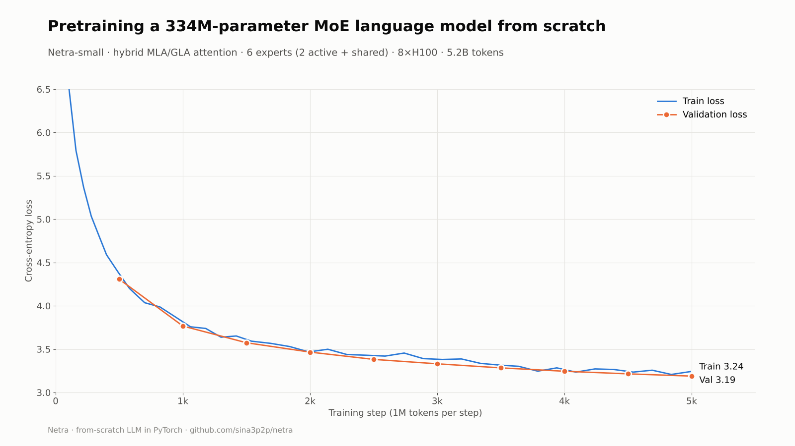
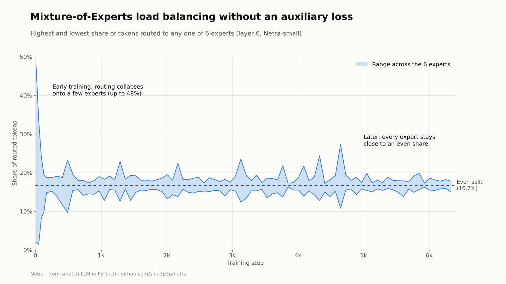

# Netra

A decoder-only language model built from scratch in PyTorch. It combines **Multi-head Latent Attention**, **Gated Linear Attention** and a **Mixture-of-Experts** feed-forward layer with auxiliary-loss-free load balancing. The repo includes the full pipeline: tokenizer training, data pre-tokenization, multi-GPU training and a chat UI.



## Highlights

- **Multi-head Latent Attention (MLA)**: keys and values are compressed into a small shared latent, which is what gets cached at inference ([DeepSeek-V2](https://arxiv.org/abs/2405.04434)).
- **Gated Linear Attention (GLA)**: a linear-time recurrence with a data-dependent forget gate ([Yang et al., 2024](https://arxiv.org/abs/2312.06635)).
- **Hybrid layout**: roughly 3 MLA layers per GLA layer, with the first and last layers always MLA (for example `MGMMMGMMMGMM` in Netra-small).
- **Mixture-of-Experts**: SwiGLU experts with top-2 routing, an optional shared expert, and **auxiliary-loss-free load balancing** ([DeepSeek-V3](https://arxiv.org/abs/2412.19437)). A per-expert bias steers routing without adding a loss term.
- **Modern building blocks**: RoPE, RMSNorm, tied input/output embeddings, scaled residual initialisation.
- **Training stack**: DDP via `torchrun`, `torch.compile`, bf16 autocast, gradient accumulation, cosine LR with warmup, gradient clipping, periodic eval and sample generation, checkpoint resume, W&B logging (including per-layer MoE load metrics) and optional Cloudflare R2 checkpoint backup.

## Results

Netra-small (334.5M total / 169.4M active parameters) trained on 8×H100 reached a **validation loss of 3.19 after 5.2B tokens** (5,000 steps at ~1M tokens per step), using a 32k BPE tokenizer.

Routing stays balanced without any auxiliary loss. Early in training a few experts take most of the tokens; the bias correction then brings every expert close to an even share:



## Model sizes

| Config | Layers | d_model | Experts (active) | Shared expert | Context | Total params | Active params |
|---|---|---|---|---|---|---|---|
| `nano` | 4 | 256 | 4 (2) | no | 512 | 15.7M | 12.6M |
| `mini` | 8 | 384 | 4 (2) | yes | 1024 | 65.4M | 46.5M |
| `small` | 12 | 640 | 6 (2) | yes | 2048 | 334.5M | 169.4M |
| `medium` | 16 | 1024 | 8 (2) | yes | 2048 | 1.24B | 488M |
| `full` | 24 | 768 | 8 (2) | yes | 2048 | 1.11B | 435M |

Active parameters count the experts a token is actually routed through.

## Quickstart

```bash
pip install -r requirements.txt
cp .env.example .env   # add WANDB_API_KEY, and R2 keys if you want checkpoint backup

# 1. Train a 32k BPE tokenizer on FineWeb
python tools/train_tokenizer.py

# 2. Pre-tokenize data into a flat binary file
python tools/tokenize_data.py --max_tokens_b 1 --out tokens.bin

# 3. Train the smallest model on one GPU
python train.py --config configs/nano.yaml --data_path tokens.bin

# 4. Train a larger model on 8 GPUs
torchrun --nproc_per_node=8 train.py --config configs/small.yaml --data_path tokens.bin --compile
```

Resume from a checkpoint with `--resume_from checkpoints/step_5000.pt`. Disable logging with `--no_wandb`.

### Cloud GPUs

- **Modal**: `modal run scripts/modal_script.py::train -- --config small` (set `NETRA_GPUS` for multi-GPU).
- **Vast.ai / RunPod**: `bash scripts/setup_vastai.sh` installs dependencies, prepares data and launches training.
- **Chat UI**: `modal serve deploy/modal_chat.py` serves a trained checkpoint through a web interface.

## Project structure

```
netra/
  model.py          Netra model: embeddings, blocks, tied LM head
  block.py          Transformer block and the hybrid MLA/GLA layout
  attention/mla.py  Multi-head Latent Attention
  attention/gla.py  Gated Linear Attention
  moe.py            SwiGLU experts and aux-loss-free routing
  rope.py, norm.py  RoPE and RMSNorm
  data.py           Streaming and memory-mapped token datasets
  tokenizer.py      BPE tokenizer wrapper
configs/            Model and training presets (nano to full)
tools/              Tokenizer training, data tokenization, R2 helper
scripts/            Modal and Vast.ai launchers
deploy/             Chat UI on Modal
tests/              Fast CPU tests
results/            Training charts
```

## Tests

```bash
pip install -r requirements-dev.txt
pytest -q
```

The tests run on CPU in a few seconds and cover forward and backward passes for each attention type, the hybrid layer layout, weight tying, and MoE routing and bias balancing.

## References

- DeepSeek-AI. *DeepSeek-V2: A Strong, Economical, and Efficient Mixture-of-Experts Language Model*, 2024.
- DeepSeek-AI. *DeepSeek-V3 Technical Report*, 2024.
- Yang et al. *Gated Linear Attention Transformers with Hardware-Efficient Training*, 2024.
- Su et al. *RoFormer: Enhanced Transformer with Rotary Position Embedding*, 2021.

## License

[MIT](LICENSE)
